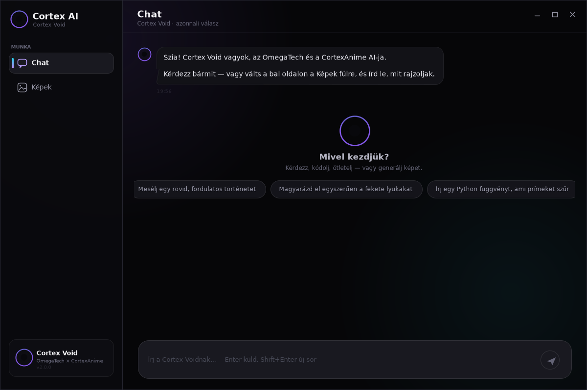
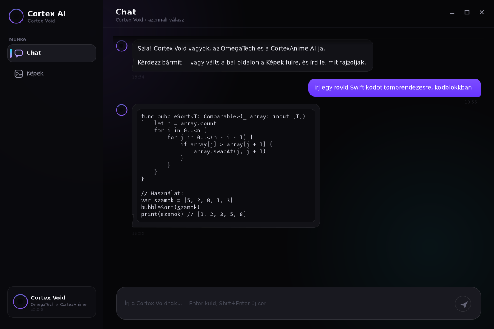
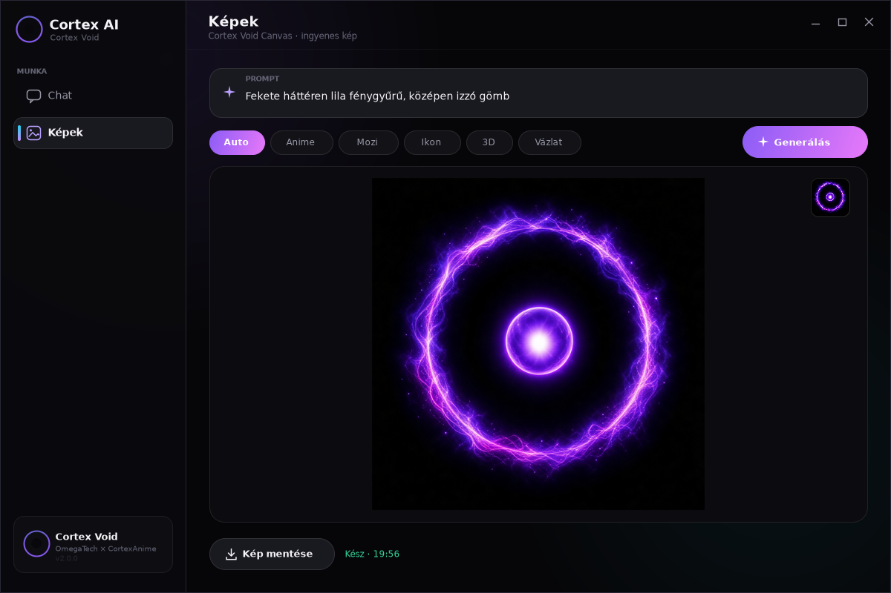

# Cortex AI for Windows — 2.0

Teljesen új felület: saját rajzolt, keret nélküli ablak, sötét márka, bal oldali sáv,
buborékos chat, kódblokkok, képstúdió. Egyetlen exe, semmilyen telepítő vagy plusz
runtime nem kell hozzá — a Windows 10/11 beépített .NET Framework 4.8-a futtatja.

| | |
|---|---|
| Fájl | `CortexAI.exe` · 316 416 B |
| sha256 | `67c1cf63a3658ba799d97e450eb52363e008e6c94e43648c3283e9133f0c19d9` |
| Cél | .NET Framework 4.5+ (AnyCPU) — Windows 10 / 11 |
| Backend | `https://cortanime.eu/api/cortexai` |
| Verzió | 2.0.0.0 |
| Ikon | `cortex.ico` (16–256 px), az exe-be égetve |

## Képernyőképek

| | |
|---|---|
|  |  |
| Kezdőképernyő javaslatokkal | Kódblokk a válaszban |



## Mi változott az 1.0-hoz képest

Az 1.0 sima WinForms volt — szürke keret, natív gombok, natív scrollbar, üres vászon.
A 2.0 mindent maga rajzol:

- **Keret nélküli ablak**, saját címkesáv minimalizálás / nagyítás / bezárás gombokkal,
  húzható fejléccel, élre illesztett átméretezéssel (`WM_NCHITTEST`), Windows 11-en
  lekerekített sarok és sötét keret (DWM)
- **Bal oldali sáv**: logó, Chat / Képek navigáció aktív jelzéssel és hover állapottal,
  alul a Cortex Void kártya
- **Chat**: saját rajzolt buborékok (felhasználó = lila grádiens jobbra, asszisztens =
  sötét kártya balra, avatarral), ``` kódblokkok külön monospace panelben, időbélyegek,
  animált „gondolkodik" pontok, saját scrollbar
- **Kezdőképernyő**: nagy gömb, „Mivel kezdjük?", három kattintható javaslat
- **Képek**: prompt kártya, 6 stílus-csempe, grádiens Generálás gomb, nagy előnézet
  forgó progress-szel, kész képnél thumbnailek és „Kép mentése"
- **Tipográfia**: Segoe UI, mérethelyes (7,25–15 pt) hierarchia; minden szöveg explicit
  balra igazítva, hogy ne függjön a rendszer alapértelmezésétől

## Telepítés

Töltsd le a `CortexAI.exe`-t, tedd egy mappába, indítsd el.
Első indításnál a SmartScreen szólhat (aláíratlan exe): *További információ → Futtatás mindenképp*.

Parancssorból a képstúdióval is indítható: `CortexAI.exe images`

## Hogyan készült

Windows nélkül, Linuxon: Mono `mcs`, .NET Framework 4.5 profil.

```bash
mcs -sdk:4.5 -target:winexe -out:CortexAI.exe \
    -win32icon:cortex.ico -resource:cortex.ico,CortexAI.cortex.ico \
    -r:System.Windows.Forms.dll -r:System.Drawing.dll -r:System.Web.Extensions.dll \
    CortexAI.cs AssemblyInfo.cs
```

A felületet Xvfb + Mono alatt futtattam és képernyőképekkel ellenőriztem (a fenti képek
onnan vannak), a hálózati kódutat pedig külön tesztprogrammal: chat ~4 s, kép 8 poll
után 824 KB PNG.

## Ami még lehet

- A chat nem streamel (egész válasz egyszerre, 1–5 s).
- A képstúdió a legutolsó 5 képet tartja a munkamenetben (nincs lemezre mentett előzmény).
- Nincs rendszertálca-ikon és nincs értesítés.
